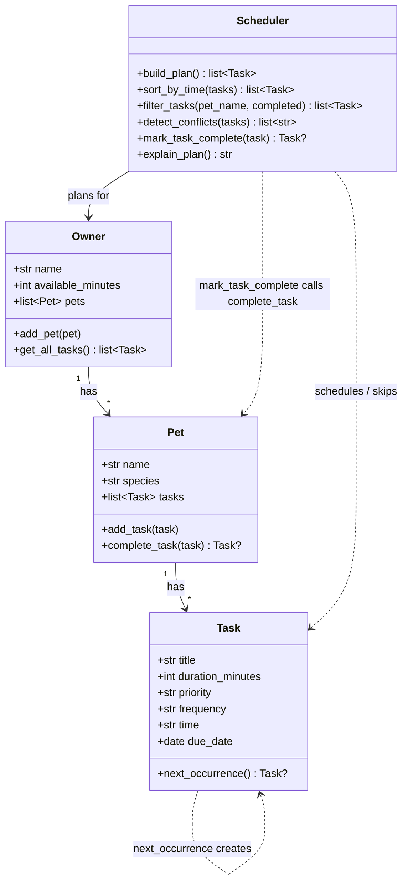

# 🐾 PawPal+

PawPal+ is a Streamlit app that helps a busy pet owner plan a day of pet care. You enter your pets, their care tasks, and how much time you have. PawPal+ then builds a timed daily schedule, explains why it picked each task, and warns you when two tasks clash.

## Scenario

A busy pet owner needs help staying consistent with pet care. They want an assistant that can:

- Track pet care tasks (walks, feeding, meds, enrichment, grooming, etc.)
- Consider constraints (time available, priority, owner preferences)
- Produce a daily plan and explain why it chose that plan

## ✨ Features

**Planning**

- **Priority-based scheduling.** Tasks are chosen highest priority first. On a tie, shorter tasks go first so more of them fit in your day.
- **Time-budget fitting (skip and continue).** A task that doesn't fit in the minutes left is skipped, and the scheduler keeps checking later tasks, since a shorter one may still fit. Skipped tasks are listed so nothing disappears silently.
- **Fixed and flexible times.** A task can have a fixed time (`"08:30"`) or be "any time". Fixed tasks keep their time. Flexible tasks fill the free gaps from the start of the day and move past fixed tasks instead of overlapping them.
- **Plan explanation.** Every plan comes with a plain-language summary: each task's time slot and priority, what was skipped and why, and how tasks were chosen.

**Sorting and filtering**

- **Sorting by time.** View tasks in clock order, with "any time" tasks last.
- **Sorting by priority.** View tasks in the same order the scheduler uses to choose them.
- **Filtering by pet and status.** Show one pet's tasks, only pending or only done tasks, or any combination.

**Conflict warnings**

- **Overlap detection.** Flags any two fixed-time tasks whose time slots overlap, not just ones that start at the same minute. A task that starts exactly when another ends is fine.
- **Clear labels.** Each warning says whether the *pet* is double-booked (same pet) or *you* are (different pets at once).
- **Warns, never crashes.** A badly formatted time like `8am` gives a warning and the task is treated as "any time". The plan is still built.

**Recurring tasks**

- **Daily and weekly recurrence.** Marking a daily or weekly task done automatically adds its next occurrence (+1 day or +7 days). `"once"` tasks don't repeat.
- **Smart next due date.** A task finished late is next due *tomorrow*, not on a date already past. A task finished early counts from its original due date, so it doesn't come back on a day it was already done.
- **Due-date aware.** Today's plan only includes tasks due today or earlier, so tomorrow's walk doesn't show up in today's schedule.

**In the app**

- Task table with priority badges (🔴 High, 🟡 Medium, 🟢 Low), status icons, and a "Showing X of Y tasks" summary.
- Conflict warnings as soon as tasks are added, before you build a schedule.
- Schedule summary (tasks scheduled, minutes used, tasks skipped), a timeline table marking each task 📌 Fixed or 🔄 Flexible, and a "Why this plan?" explanation.

## 🚀 Getting started

### Setup

```bash
python -m venv .venv
source .venv/bin/activate  # Windows: .venv\Scripts\activate
pip install -r requirements.txt
```

> On Windows, if `python` opens the Microsoft Store, use `py` instead.

### Run the app

```bash
streamlit run app.py
```

### Run the terminal demo

```bash
python main.py
```

## 🧩 Implementation Summary

The logic layer lives in `pawpal_system.py` and has four classes:

- **`Task`**: one care activity: title, duration, priority, category, frequency, optional fixed `time`, `due_date`, and completion status. It can mark itself complete, turn its priority into a number for sorting, and create its next occurrence.
- **`Pet`**: a pet's details and its list of tasks. Adding a task stamps it with the pet's name. Completing a task adds the next occurrence to the same pet.
- **`Owner`**: the owner's name, available minutes for the day, and their pets. `get_all_tasks()` returns every pet's tasks in one list.
- **`Scheduler`**: the planner. It reads tasks from `Owner.get_all_tasks()`, so it works across all pets.

**How a plan is built:** `Scheduler.build_plan()` keeps tasks that aren't completed and are due by the plan date. It sorts them by priority (shorter first on ties) and adds them while they fit in the owner's available minutes. Then it gives each task a time slot and checks for conflicts. `explain_plan()` turns the result into readable text.

`app.py` is the Streamlit UI, `main.py` is a terminal demo with two pets, and `tests/test_pawpal.py` holds the pytest tests.

### System design

The full class diagram is in [diagrams/uml_final.mmd](diagrams/uml_final.mmd).



## 🖥️ Sample Output

Output of `python main.py` (one owner with 90 minutes, two pets, six tasks, two deliberate clashes):

```
=== Today's Schedule ===
Daily plan for Jordan on 2026-10-24 (75 of 90 minutes used):
  08:00-08:10  Mochi: Breakfast (10 min) [priority: high] (fixed time)
  08:00-08:10  Luna: Feeding (10 min) [priority: high] (fixed time)
  08:10-08:30  Luna: Play time (20 min) [priority: medium]
  08:30-09:00  Mochi: Morning walk (30 min) [priority: high] (fixed time)
  08:45-08:50  Luna: Give medication (5 min) [priority: high] (fixed time)
Skipped (not enough time left):
  Mochi: Bath (45 min) [priority: low]
Warnings:
  [different pets] Mochi: Breakfast at 08:00 at the same time as Luna: Feeding at 08:00
  [different pets] Mochi: Morning walk at 08:30 overlaps Luna: Give medication at 08:45
Tasks are chosen highest priority first; on a tie, shorter tasks go first so more of them fit. Fixed-time tasks keep their time, and the others fill the free gaps starting at 08:00.

=== All tasks sorted by time ===
     08:00  Mochi: Breakfast [pending, due 2026-10-24]
     08:00  Luna: Feeding [pending, due 2026-10-24]
     08:30  Mochi: Morning walk [pending, due 2026-10-24]
     08:45  Luna: Give medication [pending, due 2026-10-24]
  any time  Mochi: Bath [pending, due 2026-10-24]
  any time  Luna: Play time [pending, due 2026-10-24]

=== Recurring task: complete Luna's feeding ===
  Done: Feeding (2026-10-24), next one due 2026-10-25

=== Filter + sort: Luna's pending tasks by time ===
     08:00  Luna: Feeding [pending, due 2026-10-25]
     08:45  Luna: Give medication [pending, due 2026-10-24]
  any time  Luna: Play time [pending, due 2026-10-24]
```

This is the first part of the output; the full run is in the [Demo Walkthrough](#-demo-walkthrough). Note how "Play time" (flexible) fills the gap at 08:10 between the fixed breakfast and walk, and how the 45-minute bath is skipped because only 15 minutes are left.

## 🧪 Testing PawPal+

```bash
# Run the full test suite:
python -m pytest

# Show each test by name:
python -m pytest -v

# Run with coverage (needs: pip install pytest-cov):
python -m pytest --cov
```

The tests live in `tests/test_pawpal.py` and check the logic layer in `pawpal_system.py`: sorting, filtering, recurring tasks, conflict detection, and how a daily plan is built, using both happy paths and edge cases.

Output of a successful run of `python -m pytest`:

```
============================= test session starts =============================
platform win32 -- Python 3.14.7, pytest-9.1.1, pluggy-1.6.0
rootdir: C:\Users\Tadele\Desktop\CodePath\ai110-module2show-pawpal-starter
configfile: pytest.ini
testpaths: tests
plugins: anyio-4.15.1, platformdirs-4.13.0
collected 37 items

tests\test_pawpal.py .....................................               [100%]

============================= 37 passed in 0.07s ==============================
```

The 37 tests cover both happy paths and edge cases:

- **Basics:** marking a task complete, adding tasks to a pet.
- **Sorting correctness:** chronological order across pets, untimed tasks last, unpadded times (`8:30` before `10:00`), priority order with shorter tasks first on ties, stable order on a full tie, and unknown priorities sorted last.
- **Recurrence logic:** a completed daily task shows up in tomorrow's plan; daily (+1 day), weekly (+7 days), and `once` tasks; year-end and leap-day rollover; late and early completion; completing a task twice adds only one next occurrence; an unknown task raises `ValueError`.
- **Conflict detection:** duplicate times, overlapping durations, same pet vs. different pets, every pair among three clashing tasks, no false alarms for different times, conflicting tasks still scheduled, invalid times give a warning instead of crashing.
- **Planning edge cases:** a pet with no tasks, an owner with no pets, 0 minutes available, tasks that exactly fill the time, a task longer than the whole budget, `build_plan()` called twice, future tasks kept out of today's plan, flexible tasks filling gaps, and filtering by a pet that doesn't exist.

**Known limits** (documented, not yet handled): a task that runs past midnight shows as `24:20`, and two pets with the same name are treated as the same pet in conflict warnings.

### Confidence Level: ★★★★☆ (4/5)

**Why 4 stars:** all 37 tests pass, and they cover every scheduling feature with both normal use and edge cases. Writing the edge-case tests found two real bugs (times like `8:30` sorting after `10:00`, and a task completed twice creating two next occurrences). Both are now fixed, and their tests fail on the old code and pass on the new code.

**Why not 5:** the two known limits above are still open. The tests cover the backend only; the Streamlit UI was checked by clicking through it, not with automated tests. And the scheduler uses a simple "highest priority first" choice, which can leave minutes unused when a different mix of tasks would fill the day better.

## 📐 Smarter Scheduling

Beyond picking tasks by priority, the scheduler can sort by time of day, filter tasks, repeat daily and weekly tasks, and warn about clashes. Tasks have two fields for this: an optional `time` (`"HH:MM"`, empty means "any time") and a `due_date`.

| Feature | Method(s) |
|---------|-----------|
| Sorting | `Scheduler.sort_by_time()`, `Scheduler.sort_tasks()` |
| Filtering | `Scheduler.filter_tasks()`, `Scheduler.build_plan()` |
| Conflict detection | `Scheduler.detect_conflicts()`, `Scheduler._assign_times()` |
| Recurring tasks | `Scheduler.mark_task_complete()`, `Pet.complete_task()`, `Task.next_occurrence()` |

### Sorting

- **`Scheduler.sort_by_time(tasks)`** returns tasks in clock order, with "any time" tasks last. It uses `sorted()` with a lambda key of `(has no valid time, minutes after midnight)`: the first item puts timed tasks before untimed ones, and the second compares times as numbers, so `"8:30"` correctly comes before `"10:00"` (as text it wouldn't).
- **`Scheduler.sort_tasks(tasks)`** orders tasks for planning: highest priority first, and shorter tasks first on a tie so more of them fit.

### Filtering

- **`Scheduler.filter_tasks(pet_name=None, completed=None)`** returns the owner's tasks narrowed by pet, by status, or both. A filter left as `None` isn't applied, and pet names ignore upper/lower case.
  ```python
  scheduler.filter_tasks(pet_name="Luna")                   # all of Luna's tasks
  scheduler.filter_tasks(completed=False)                   # pending tasks, every pet
  scheduler.filter_tasks(pet_name="Mochi", completed=False) # Mochi's pending tasks
  ```
- **`Scheduler.build_plan()`** only plans tasks that aren't completed and are due on or before the plan date. If a task doesn't fit in the time left, it's skipped and the scheduler keeps going, because a shorter task later may still fit.

### Conflict detection

- **`Scheduler.detect_conflicts(tasks)`** turns each fixed-time task into a start–end slot in minutes and compares every pair (`itertools.combinations`). Two tasks clash when one starts before the other ends, so it catches overlapping durations, not just identical start times. A task that starts exactly when another ends is fine.
- It's lightweight: it **returns warning messages instead of raising errors**, and it never moves a task. `build_plan()` stores the warnings in `scheduler.conflicts`, and `explain_plan()` prints them under "Warnings:". Each warning has a label:
  ```
  [same pet] Mochi: Walk at 08:00 at the same time as Mochi: Feeding at 08:00
  [different pets] Mochi: Morning walk at 08:30 overlaps Luna: Give medication at 08:45
  [invalid time] Mochi: Walk has time '8am' (expected HH:MM), so it was treated as any time
  ```
- **`Scheduler._assign_times(tasks)`** keeps fixed-time tasks at their time and places "any time" tasks into the free gaps starting at `day_start`, so the scheduler itself never creates a conflict.

### Recurring tasks

- **`Scheduler.mark_task_complete(task)`** finds which pet owns the task and completes it through **`Pet.complete_task()`**. That marks the task done and adds the copy that **`Task.next_occurrence()`** creates.
- The next due date is `max(due_date, completed_on)` plus **1 day** for `"daily"` or **7 days** for `"weekly"`, using `timedelta` so month and year ends roll over correctly. A task finished late is next due tomorrow, not on a date that's already past. A task finished early counts from its original due date instead, so it doesn't come back on a day it was already done. `"once"` tasks don't repeat.
- The new copy is due in the future, so it doesn't show up in today's plan.

**Tradeoffs:** see section 2b of [reflection.md](reflection.md).

## 📸 Demo Walkthrough

A text walkthrough of the app, so you can follow along without watching a video.

### Main UI features

Launch the app with `streamlit run app.py`. It opens in your browser as one page, top to bottom:

| Section | What you can do |
|---------|-----------------|
| **Owner** | Enter your name and how many minutes you have today. |
| **Add a Pet** | Add a pet with a name, species (dog, cat, other), and age. Pets are listed in a table. |
| **Add a Task** | Give a pet a task: title, duration, priority (low/medium/high), an optional fixed time (`HH:MM`), and how often it repeats (daily, weekly, once). Invalid times like `25:99` are rejected with an error. |
| **Tasks** | Filter the task table by **Pet** and **Status** (pending, done, all) and sort it by **Time** or **Priority**. Overlapping tasks show a ⚠️ warning right away. Use **Mark a task done** to complete a task. |
| **Build Schedule** | Click **Generate schedule** to get today's timed plan, with conflicts, skipped tasks, and a **Why this plan?** explanation. |

### Example workflow

1. **Set up the owner.** Enter `Jordan` and `60` minutes available.
2. **Add two pets.** Add `Mochi` (dog, 3) and `Luna` (cat, 5). Both appear in the pet table.
3. **Add tasks.**
   - Mochi: `Walk`, 30 min, high, fixed time `08:00`, daily
   - Luna: `Feed`, 10 min, medium, fixed time `8:15`, daily (saved as `08:15`)
   - Mochi: `Brush`, 15 min, low, no fixed time
4. **Check the task list.** It shows "Showing 3 of 3 tasks, sorted by time.", with Walk and Feed first and Brush ("Any time") last. A warning appears right away: *⚠️ You're double-booked: Mochi: Walk at 08:00 overlaps Luna: Feed at 08:15.* Switch **Sort by** to Priority, or set **Pet** to Mochi, to see the table change.
5. **Generate today's schedule.** The summary shows **3 scheduled, 55 / 60 minutes used, 0 skipped**, a red conflict banner with the same warning, and this timeline:

   | Time | Pet | Task | Priority | Type |
   |------|-----|------|----------|------|
   | 08:00 – 08:30 | Mochi | Walk | 🔴 High | 📌 Fixed |
   | 08:15 – 08:25 | Luna | Feed | 🟡 Medium | 📌 Fixed |
   | 08:30 – 08:45 | Mochi | Brush | 🟢 Low | 🔄 Flexible |

6. **Tighten the time budget.** Change *Minutes available today* to `40` and generate again. Walk and Feed still fit (40 minutes), so the low-priority Brush moves to the **Skipped** list with a ⏭️ warning.
7. **Mark a task done.** Choose *Mochi: Walk* under **Mark a task done**. The app confirms *"Done: Walk. Next one added for 2026-10-25."* and the new Walk appears in the table with tomorrow's due date. Set **Status** to Done to see the finished one.

### Key Scheduler behaviors shown

- **Sorting by time:** the task table and the timeline are in clock order, with "any time" tasks last (`sort_by_time`).
- **Sorting by priority:** the Priority sort matches the order the scheduler picks tasks: high first, shorter first on a tie (`sort_tasks`).
- **Filtering:** the Pet and Status dropdowns call `filter_tasks`, and only pending tasks due today are planned.
- **Conflict warnings:** overlapping fixed-time tasks are flagged as "same pet" or "different pets" without stopping the plan (`detect_conflicts`).
- **Gap filling:** flexible tasks like Brush are placed in free time around fixed tasks and never cause a clash (`_assign_times`).
- **Time budget:** tasks that don't fit in the minutes left are skipped and listed, and the scheduler keeps checking shorter tasks (`build_plan`).
- **Daily recurrence:** completing a daily or weekly task adds its next occurrence (`mark_task_complete` → `complete_task` → `next_occurrence`).

### Sample CLI output

The same behaviors, run from the terminal with `python main.py`:

```
=== Today's Schedule ===
Daily plan for Jordan on 2026-10-24 (75 of 90 minutes used):
  08:00-08:10  Mochi: Breakfast (10 min) [priority: high] (fixed time)
  08:00-08:10  Luna: Feeding (10 min) [priority: high] (fixed time)
  08:10-08:30  Luna: Play time (20 min) [priority: medium]
  08:30-09:00  Mochi: Morning walk (30 min) [priority: high] (fixed time)
  08:45-08:50  Luna: Give medication (5 min) [priority: high] (fixed time)
Skipped (not enough time left):
  Mochi: Bath (45 min) [priority: low]
Warnings:
  [different pets] Mochi: Breakfast at 08:00 at the same time as Luna: Feeding at 08:00
  [different pets] Mochi: Morning walk at 08:30 overlaps Luna: Give medication at 08:45
Tasks are chosen highest priority first; on a tie, shorter tasks go first so more of them fit. Fixed-time tasks keep their time, and the others fill the free gaps starting at 08:00.

=== All tasks in the order they were added ===
     08:30  Mochi: Morning walk [pending, due 2026-10-24]
  any time  Mochi: Bath [pending, due 2026-10-24]
     08:00  Mochi: Breakfast [pending, due 2026-10-24]
     08:00  Luna: Feeding [pending, due 2026-10-24]
     08:45  Luna: Give medication [pending, due 2026-10-24]
  any time  Luna: Play time [pending, due 2026-10-24]

=== All tasks sorted by time ===
     08:00  Mochi: Breakfast [pending, due 2026-10-24]
     08:00  Luna: Feeding [pending, due 2026-10-24]
     08:30  Mochi: Morning walk [pending, due 2026-10-24]
     08:45  Luna: Give medication [pending, due 2026-10-24]
  any time  Mochi: Bath [pending, due 2026-10-24]
  any time  Luna: Play time [pending, due 2026-10-24]

=== Recurring task: complete Luna's feeding ===
  Done: Feeding (2026-10-24), next one due 2026-10-25

=== Filter: Mochi's tasks ===
     08:30  Mochi: Morning walk [pending, due 2026-10-24]
  any time  Mochi: Bath [pending, due 2026-10-24]
     08:00  Mochi: Breakfast [pending, due 2026-10-24]

=== Filter: completed tasks ===
     08:00  Luna: Feeding [done, due 2026-10-24]

=== Filter + sort: Luna's pending tasks by time ===
     08:00  Luna: Feeding [pending, due 2026-10-25]
     08:45  Luna: Give medication [pending, due 2026-10-24]
  any time  Luna: Play time [pending, due 2026-10-24]
```

**Screenshot or video** *(optional)*: <!-- Insert a screenshot or link to a demo video here -->
